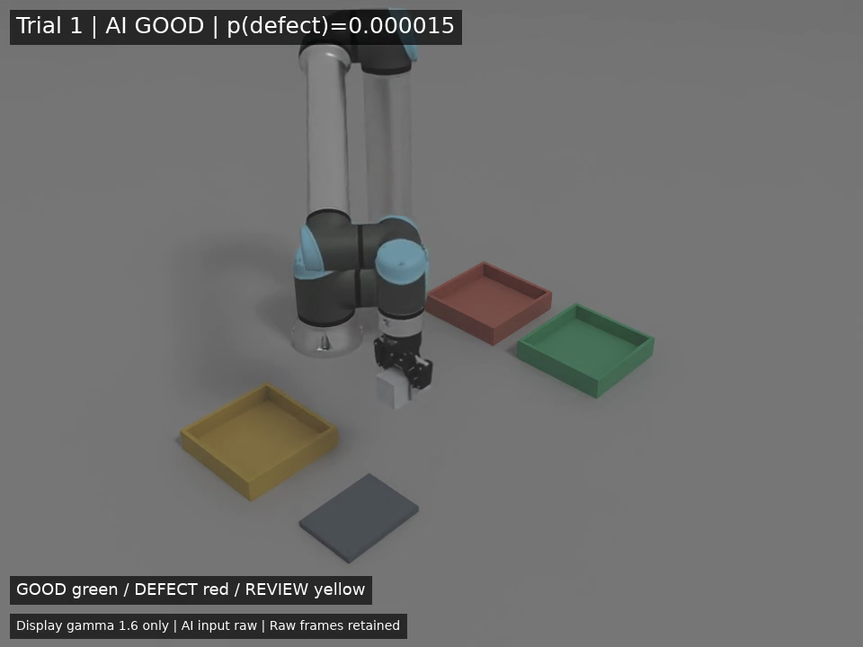

# AI外観検査・仕分けセル

Physical AI 応用1講座の最終課題。Isaac Sim 上の UR10e + Robotiq 2F-85 で直方体部品を撮影し、小型 CNN が上面の模擬汚れを判定して「良品 / 不良品 / 要確認」のトレイに運び分ける。

標準プロファイルは NVIDIA 組立済み UR10e の **native Robotiq 2F-85 variant**。流用元のチュートリアルアセットには2F-140由来のメッシュが含まれていたため、85用の参照と運動学定義を追加して切り替えた。物理搬送の成功範囲と試行件数は [docs/RESULTS.md](docs/RESULTS.md) を参照。

供給位置と姿勢は固定し、部品を1個ずつ検査する。部品の供給装置や実機への接続は対象外。分類器への入力は RGB 画像だけで、シミュレータの正解ラベル・物体名・搬送先を特徴に使わない。

実測値と未達事項は [docs/RESULTS.md](docs/RESULTS.md)、提出前の確認は [docs/SUBMISSION.md](docs/SUBMISSION.md) を参照。実装済みの機能と実測で成功した範囲を区別して記録する。

## 構成

```text
main.py                         検査 → 判定 → 搬送 → 結果保存
run.sh                          Isaac Sim アプリ起動
run_python.sh                   Isaac 同梱 Python で学習・評価などを実行
scripts/generate_dataset.py     条件グループ単位で分離した画像を生成
scripts/train_classifier.py     小型 CNN 学習・検証しきい値決定
scripts/evaluate_classifier.py  固定済みモデルを独立 test で評価
scripts/baseline.py             流用元の搬送ベースライン
scripts/summarize_runs.py       搬送 metrics JSON / 検査 JSONL の集計
scripts/make_video.py           カメラ PNG 連番から MP4 を作成
config/demo_conditions.json     valから選んだ3経路確認用の外観条件
src/sorter/cell_scene.py        部品・模擬汚れ・照明・カメラ・3トレイ
src/sorter/robot_profiles.py    組立済みnative 2F-85 variantを参照
src/sorter/vision/              前処理・CNN・画像だけの推論・評価
src/sorter/planning/            ロボットの把持・搬送制御
src/sorter/measurement.py       全体形状・開放後静止の検証、CSV / JSONL
tests/                         分離漏れ・判定・搬送測定の検証
```

`data/`、`models/`、`artifacts/`、`recordings/` は生成物で、Git の追跡対象から除外する。Isaac Sim 本体と NVIDIA アセットは同梱しない。

## セットアップ

検証環境は NVIDIA DGX Spark / GB10、Linux aarch64、Isaac Sim **6.0.0-rc.22**。Isaac Sim 付属の Python・PyTorch・NumPy・Pillow を利用する。ROS 2、scikit-learn、外部 AI API は不要。学習は標準で **ローカル CPU の PyTorch** を使い、有料の外部学習サービスや API 呼び出しによる費用は発生しない構成。GPU 学習が必要な場合のみ `train_classifier.py --device cuda` を選択する。

Isaac Sim を別途用意してから、リポジトリのルートで実行する。インストール場所は環境変数で指定できる。

```bash
export ISAAC_ROOT=/path/to/IsaacSim/release
./run.sh --help
```

`ISAAC_PYTHON` で `python.sh` 自体の場所も指定できる。初期値は `ISAAC_ROOT/python.sh`。ランチャーは GB10 の実行に必要な Isaac 同梱 PyTorch ライブラリへの参照を追加する。システム Python へのパッケージ追加や sudo は不要。

初回のロボットアセット取得にはネットワークと待ち時間が必要。アセットの参照ルートは `ISAAC_ASSET_ROOT` で指定できる。標準の85プロファイルは、その配下の組立済みUR10e USDAを参照する。

```bash
export ISAAC_ASSET_ROOT=/path/to/Isaac/6.0
```

アセット本体は公開リポジトリにコピーしない。起動が止まったように見える場合は `[startup]` の最後の段階と Isaac の警告・例外を確認する。モデル学習時には SimulationApp を起動する必要はない。

## 画像生成・学習・評価

以下は再現用の実行手順であり、成功済みの実測結果を表すものではない。出力済みのモデルや test 評価を残すため、再実験には新しい出力先を使う。

```bash
SORTER_ENTRYPOINT=scripts/generate_dataset.py ./run.sh --headless \
  --out-dir data/inspection-v1 --groups 150 --seed 42

./run_python.sh scripts/train_classifier.py \
  --manifest data/inspection-v1/manifest.json \
  --out-dir models/inspection --epochs 100 --seed 42

./run_python.sh scripts/evaluate_classifier.py \
  --manifest data/inspection-v1/manifest.json \
  --model-dir models/inspection --out artifacts/test_evaluation.json
```

150条件グループで各条件の良品・不良品を対にして、合計300枚を生成する。train / val / test は条件グループの 60% / 20% / 20%（180 / 60 / 60枚）。照明、部品の色、汚れの位置・大きさ・濃さを変え、test には暗い照明の条件も含める。同じ条件の対を別の split に分けない。manifest の読み込み時にもグループ漏れ・画像重複・クラス不足を検査する。

CNN は 64×64 RGB を入力とする3層の小型畳み込みモデルで、学習を最初から行う。train だけで重みを更新し、val で採用 epoch、スコアの temperature、要確認の信頼度しきい値を決定する。`confidence = max(不良スコア, 1 - 不良スコア)` が val で決めた値を下回れば `review`、それ以外はスコア0.5を境に `good` / `defect` とする。

比較方式は画像中央の明度の下位10%点を使う単純しきい値。明度方式も train で基準を求め、val で要確認の範囲を決める。test は設定変更に使用せず、`evaluate_classifier.py` で独立して測る。出力には正解率、要確認率、採用率、採用分の誤り率、条件別評価、誤分類画像名を残す。要確認を増やすほど誤りが小さく見えるため、正解率と採用率を併記する。

主な出力:

- `data/inspection-v1/manifest.json`: 条件・ラベル・split と相対画像パス。
- `models/inspection/classifier.pt`: CNN の重み・前処理・校正値・判定しきい値。
- `models/inspection/brightness.json`: 明度方式の設定。
- `models/inspection/training.json`: 学習履歴と val 評価。test は含まない。
- `artifacts/test_evaluation.json` / `.predictions.csv`: 固定済み2方式の test 評価。

## 検査・仕分けの実行

学習済みモデルを使い、良品と不良品を交互に検査する例:

```bash
./run.sh --headless --trials 2 \
  --model models/inspection/classifier.pt --sequence good,defect \
  --output-dir artifacts/demo
```

`--sequence` はシミュレータで生成する部品の順番であり、分類器には渡さない。`good` が良品、`defect` が模擬汚れあり。行先は撮影画像への推論結果で選択する。要確認の発生は val で固定した信頼度範囲による。

標準の `--sequence good,defect` でも、valで決めた相対的な信頼度境界に入れば `review` になる。これは要確認への振り分けとして正常な動作。3経路の接続を確認する場合は、次の外観条件ファイルを使用する。

```bash
./run.sh --headless --trials 3 \
  --model models/inspection/classifier.pt \
  --conditions config/demo_conditions.json --output-dir artifacts/demo_three_routes
```

`--conditions` は `--sequence` に代わって、ファイル内の外観条件を順番に繰り返す。`demo_conditions.json` の3条件は、valから良品・不良品・要確認の経路確認用に選んだ候補。画像を再撮影してから分類器が行先を決めるため、ファイル内に行先の指定はなく、描画の変動で判定が変わる場合もある。この条件の試行は、固定条件での物理搬送とAI接続の検証に使い、分類精度のbenchmark集計には含めない。

標準は `--robot-profile robotiq85 --ee-offset 0.13`。85の開いたpadはbaseからZ方向に約0.110〜0.148 m、中央0.1294 mにあるため、オフセット0.13 mで部品中心付近を挟む。base姿勢は下向き・yaw=0で、指はworld Y方向から短辺0.0515 mを挟む。これらは静的形状から決めた初期設定であり、把持成功率は実測で確認する。

制御は200 Hzで1物理ステップずつ進め、描画を分離する。手先はCartesian空間の直線経路に沿ってIKを更新し、関節指令に0.9 rad/sの上限を設ける。主な標準設定は次のとおり。

| 設定 | 値 |
|---|---|
| 接近 / 搬送 | 0.15 / 0.12 m/s |
| 下降 / 置き下降 | 0.04 / 0.04 m/s |
| 持上げ / 退避 | 0.08 / 0.08 m/s |
| 部品質量 | 0.2 kg |
| グリッパー角度指令の変化上限 | 0.4 rad/s |
| グリッパーangular drive | `damping=2`, `maxForce=8` |
| 指のmimic関係 | native `Physx_Mimic` を維持 |

把持できていないまま搬送を続けないよう、持上げ後に部品高さを検査する。比較用の旧140アセットは `--robot-profile legacy140 --ee-offset 0.20` で明示的に選べる。旧アセットのUSDを直接指定する場合だけ `ROBOT_USD` を使用する。85と140の結果は別に集計する。

分類器を使わず、搬送機構だけを個別に検証する例:

```bash
./run.sh --headless --trials 3 --motion-only good \
  --output-dir artifacts/motion_good
./run.sh --headless --trials 3 --motion-only defect \
  --output-dir artifacts/motion_defect
./run.sh --headless --trials 3 --motion-only review \
  --output-dir artifacts/motion_review
```

このモードの結果は AI による仕分け成功率と分けて集計する。機構のみの良品行きは、独立3試行で3/3成功を確認した。実行設定・制約と他の試行結果は [docs/RESULTS.md](docs/RESULTS.md) を参照。

ここで1試行は、毎回ロボットの初期関節状態と部品の供給位置・姿勢へリセットして開始する独立episode。同じ部品を戻して繰り返し、連続供給装置やトレイへの20部品の蓄積は対象外とする。失敗時停止では、指定試行数より少ない件数で終わる場合がある。

失敗例も含めて指定件数を測る評価専用モードでは、明示的に `--continue-after-failure` を付ける。試行間で供給位置とロボット姿勢をリセットする。通常のデモ実行は失敗時停止を使う。

```bash
./run.sh --headless --trials 20 --continue-after-failure \
  --model models/inspection/classifier.pt --conditions config/demo_conditions.json \
  --output-dir artifacts/evaluation20
```

この20試行は3つのデモ条件を繰り返した、物理搬送と判定接続の評価。分類accuracyは、別途 `evaluate_classifier.py` による独立testの値を報告する。

成功判定は、**部品の全体が指定トレイ内に入り、床の近くにあり、グリッパー開放後に連続して静止すること**。回転した部品の全体 AABB を使い、中心位置だけでは成功にしない。標準の静止しきい値は並進速度0.015 m/s未満・角速度0.15 rad/s未満を連続60 physics steps。200 Hz の場合は0.30秒に相当する。各試行の実際の設定と判定理由は保存された metrics を優先する。

検査画像、不良スコア、信頼度、行先、搬送結果・失敗理由を出力先へ保存する。`metrics.json` が試行全体、`inspections.csv` / `inspections.jsonl` が検査ログ。CSV と JSONL は試行ごとに追記し、途中で停止しても確定済みの結果を残す。`METRICS_OUT` で metrics JSON の保存先を上書きできる。物理搬送の成功と、正解ラベルに対する仕分けの正しさは別に確認し、要確認に運んだ件数も併記する。

既存の検査ログ・metrics・検査画像がある出力先と、既存フレームがある録画先は再利用を拒否する。再実行には新しいディレクトリを指定する。起動・撮影・分類のエラーでも `status=error` と簡潔な停止理由を metrics に残し、終了コードを非0にする。試行中の撮影・分類エラーは失敗行も保存する。検査画像の range / std を保存し、完全に一様な画像は失敗として停止する。

```bash
python3 scripts/summarize_runs.py 'artifacts/motion_*/metrics.json' \
  --out artifacts/motion_summary.json
```

同一試行の metrics と JSONL を二重に入力しない。未確定・不明の結果は実測成功率の分母から分けて報告する。旧 `scripts/baseline.py` の距離中心の成功判定と、新セルの厳密な成功判定も混ぜない。

`summary.success_rate` は要確認への搬送も含むセル処理の成功率。良否分類の正解率は独立 test 評価を使い、運転時は `classification_coverage`、`accepted_route_accuracy`、`review` 件数を合わせて読む。`cycle_time` は実際の処理経過秒、`simulation_seconds` は供給から静止判定までのシミュレーション時間、`motion_simulation_seconds` はロボット制御区間の時間。

## フレーム保存と試し動画

ターミナルやデスクトップ全体を撮らず、シミュレーションのカメラ視点だけを連番保存する。検査画像を待つ間も共通のphysics/render callbackを通し、録画に含める。

```bash
./run.sh --headless --trials 3 \
  --model models/inspection/classifier.pt --conditions config/demo_conditions.json \
  --output-dir artifacts/recording_demo --record-dir recordings/demo/frames

python3 scripts/make_video.py recordings/demo/frames recordings/demo.mp4 --fps 20
```

エンコードには ffmpeg が必要。利用できない場合も PNG 連番を保存できる。標準は `--record-every 10`、物理時間刻み0.005秒なので20 fps。保存間隔を変える場合は `--fps = 200 / record-every` に合わせる。動画はシミュレーション時間に対応し、処理にかかった実時間とは異なる。提出動画で倍速を使う場合は動画内または概要欄に明記する。

## 検証と制約

```bash
./run_python.sh -m unittest discover -s tests -v
```

分類器の評価対象はシミュレーションで生成した画像。実カメラ・実部品への汎化性能は未評価。固定位置・固定姿勢・既知寸法で制御するため、未知姿勢の検出や供給装置の自動化は含まない。把持の失敗、到達不能、カメラ画像取得失敗、タイムアウトは成功に数えず、停止理由を残して調整する。

実測で未完の部分は [docs/RESULTS.md](docs/RESULTS.md) に記載する。結果や動画を公開する前に、生成物・ログ・画面内の文字に個人情報、認証情報、業務データが含まれないことを確認する。

## 流用範囲とアセットの出典

既存の Isaac Sim 搬送実験から、`planning/` の IK・把持搬送制御、`tasks/`、`perception/` の必要なコードをコピーしている。元の実験リポジトリへの実行時依存はない。今回の課題用に部品・汚れ・検査用シーン、小型 CNN と明度比較、条件分離、判定接続、厳密な成功測定、検査ログ・録画を追加した。現在の `fixed_cell_controller.py` はコピーした IK 実装を基に、関節インデックス処理、収束確認、段階ごとの停止判定を組み立てている。

`src/sorter/planning/rmpflow/ur10e.urdf`、`robot_descriptor.yaml`、`ur10e_rmpflow_common.yaml` は NVIDIA Isaac Sim の UR10e サンプルに由来する運動学定義・設定。YAML 内の NVIDIA 著作権表示・Apache-2.0 のヘッダーを保持している。85用の [profiles/ur10e_85](src/sorter/planning/profiles/ur10e_85/README.md) は既存arm6軸とrootの数値だけを再利用し、指・メッシュなしのIK専用URDFとdescriptorを用意した。流用元・ライセンス（Apache-2.0）・変更点の一覧は [THIRD_PARTY_NOTICES.md](THIRD_PARTY_NOTICES.md) を参照。

85用armの局所変換・ゼロ姿勢FKとUSDとの最大成分誤差は1.47e-7、マウントは1.63e-7以下で、許容1e-6以内。`static_evidence.json` に参照URL・SHA256・比較値を保存した。実行時にも、USDの手先実姿勢とLula FKがログの表示精度で一致したことを確認している。この整合性確認は、物理搬送の成功確認とは分けて扱う。

表示・接触計算用の標準ロボットは NVIDIA Isaac Sim 6.0 の `Isaac/Robots_Multiphysics/UniversalRobots/ur10e/ur10e.usda` を実行時に参照し、`Physics=physx` / `Gripper=Robotiq_2F_85` を選択する。比較用140だけは `Isaac/Samples/Rigging/Manipulator/configure_manipulator/ur10e/ur/ur_gripper.usd` を参照する。USD 本体・メッシュ・テクスチャ・Isaac Sim 本体はリポジトリへ同梱しない。旧URDFに記載されたメッシュ名も元アセット由来の参照であり、同名メッシュのコピーは含めない。アセット利用条件は NVIDIA の配布条件に従う。

## 提出用動画・レポート

提出用動画は `recordings/PAI最終課題_142245.mp4`。日本語の目的説明・処理フロー、AI入力の拡大画像付き3試行、評価結果、工夫と限界を約150秒にまとめた。搬送映像はシミュレーション時間に対して等速で、試行ごとの初期化を含む。全景のみ表示gammaを1.6に補正し、AI入力は64×64へ縮小後に無補正で拡大表示する。日本語字幕で説明し、音声は付けていない。元の `recordings/demo.mp4` とPNG連番は保持している。



最初の3試行だけ録画し、残りを同じ条件で測定する例:

```bash
./run.sh --headless --conditions config/demo_conditions.json --trials 20 \
  --continue-after-failure --output-dir artifacts/evaluation20 \
  --record-dir recordings/demo/frames --record-trials 3
python3 scripts/make_video.py recordings/demo/frames recordings/demo.mp4 \
  --fps 20 --metrics artifacts/evaluation20/metrics.json --trials 3 --gamma 1.6
python3 scripts/make_video.py --submission
python3 scripts/build_report.py
```

提出用レポートは `artifacts/report/説明資料_PAI最終課題_142245.pdf`（A4・6ページ）と同名のHTMLに出力する。PDF生成にはWeasyPrint、共通の図版生成にはPillowと日本語フォント（Noto Sans CJK）、動画生成にはffmpegとNumPyを使う。既存環境の `python3` で実行できる。`--html-only` でPDF生成を省略できる。動画の再生成には `--submission --overwrite` を指定する。新たなシミュレーション・学習・外部API呼び出しは行わない。

図版と目視確認用の画像は `review/submission/`、動画の編集区間・試行ログ対応は `artifacts/submission_build/timeline.json` に保存する。動画とPDFは `docs/classification_metrics.json` と、同一内容であることを確認した公開用・元の搬送ログから生成する。GitHub・動画URLはPDF内の「（提出時に記入）」に記入する。GitHub・YouTubeの公開やOmniCampus提出は自動実行しない。

実セルでの判定だけを確認する場合:

```bash
SORTER_ENTRYPOINT=scripts/preview_inspection.py ./run.sh --headless \
  --conditions config/demo_conditions.json --model models/inspection/classifier.pt \
  --out-dir artifacts/preview/new-run
```

この確認は搬送を実行せず、分類benchmarkの件数にも加えない。`SORTER_DEBUG=1` で実行時の例外詳細を端末ログへ出せる。録画対象はカメラ画像だけとする。

## ライセンス

[Apache License 2.0](LICENSE)。NVIDIA Isaac Sim のサンプルに由来するファイルの著作権表示と変更点は [THIRD_PARTY_NOTICES.md](THIRD_PARTY_NOTICES.md) に記載。Isaac Sim 本体・NVIDIA アセットは同梱しておらず、NVIDIA の配布条件に従う。
