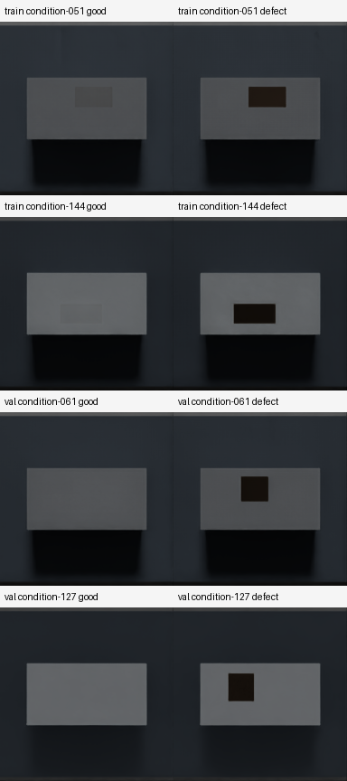
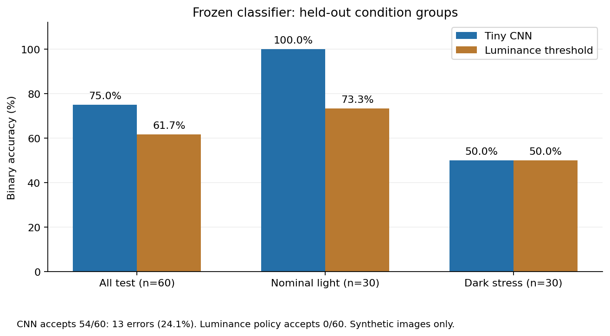

# 画像分類の実測結果

2026年10月20日、Isaac Sim 6.0.0-rc.22 / aarch64 / NVIDIA DGX Spark（GB10）で生成した固定カメラ画像を評価した。**凍結した小型CNNのtest正解率は75.0%（45/60枚）、単純輝度しきい値は61.7%（37/60枚）だった。通常照明ではCNNが30/30枚正解したが、暗照明では良品15枚すべてを不良品と誤認した。要確認への振り分けでも、この照明変化を十分検出できなかった。**

この資料は画像分類だけの測定である。実際の把持・搬送・開放後静止の成功率は [RESULTS.md](RESULTS.md) に分けて記録する。数値の公開用要約は [classification_metrics.json](classification_metrics.json)、詳細な実行時出力は `artifacts/test_evaluation.json` と同名の `.predictions.csv` に保存した。

## データと評価の分離

同じ直方体に対して上面の模擬汚れの有無を切り替え、192×192のRGB画像を生成した。各条件グループは本体色、照明、汚れの位置・寸法・色を共有する良品と不良品の2枚で構成する。撮影順はグループごとにランダム化した。

| 分割 | 条件グループ | 画像 | 良品 | 不良品 | 用途 |
|---|---:|---:|---:|---:|---|
| train | 90 | 180 | 90 | 90 | CNNの重み、輝度しきい値を学習 |
| val | 30 | 60 | 30 | 30 | epoch、温度、要確認帯を決定 |
| test | 30 | 60 | 30 | 30 | モデル確定後に1回だけ評価 |
| 合計 | 150 | 300 | 150 | 150 | 生成seed 42 |

manifestの条件グループIDが分割間で重ならないこと、条件辞書そのものの重複が分割をまたがないこと、画像パスの重複がないこと、各分割に両クラスがあることを検証した。画像・条件の一覧は `data/inspection-v1/manifest.json` に保存した。旧debug画像は学習・評価に使用していない。

本体の灰色設定は0.40〜0.82、汚れ幅は0.014〜0.042 m、高さは0.010〜0.025 m、汚れの灰色設定は0.025〜0.16とした。通常照明のDomeLight設定は25〜110、DistantLight設定は40〜260。testのうち15グループ30枚は、DomeLightを12〜18、DistantLightを15〜35に下げた暗照明の追加条件である。これらはレンダーの設定値であり、実機の照度との対応は測定していない。

## CNNと比較手法

CNNは外部の学習済み重みを使わず、このtrain画像から学習した。RGBを64×64に縮小し、3段の畳み込み、空間プーリング、全結合層で不良スコアを出す。学習可能パラメータは17,225個。画像の画素だけを入力し、物体名・正解ラベル・照明設定・manifestの条件を推論へ渡さない。

学習はCPU・2 threads、seed 42、batch size 32、Adam、学習率0.003で100 epochs実行した。trainにのみ上下左右反転と0.9〜1.1倍の明度変化を加えた。val損失が最も小さいepoch 93を採用した。学習ループと検証・校正の記録時間は **13.0秒**。Isaac起動と300枚の画像生成時間は含めない。

比較手法は、固定された部品上面内のROI（中央の幅60%・高さ30%）で算出する輝度の10%分位点に、単一のしきい値を適用する方式である。trainから決めたしきい値は0.1697545126で、暗い側を不良品とする。物体領域を含むようROIを固定し、暗い周囲の治具を比較の特徴に含めない。

## valで固定した要確認帯

不良スコアを `p`、確信度を `max(p, 1-p)` とする。温度はvalの負の対数尤度で決めた。ただし、少量の完全分離可能なvalでスコアを数値的に飽和させないよう、温度を1〜10の範囲に制限し、確信度をさらに尖らせる校正を禁止した。採用した温度は1.0である。この方針の決定もtestを読む前に行った。

val確信度の10%分位を起点に、採用された画像の誤り率が5%以下となる最も採用率の高いしきい値を選んだ。同値の確信度は採用するため、10%の要確認率を厳密に保証する規則ではない。

- CNNの確信度しきい値: **0.9996913274226139**。
- `0.0003086725773860932 < p < 0.9996913274226139` は `review`。
- 帯域外では `p < 0.5` を `good`、`p >= 0.5` を `defect` とする。境界値は採用する。
- valでは54/60枚を採用し、採用された画像の誤りは0/54枚だった。
- 輝度法では、探索した非空の採用集合がval誤り率5%以下を満たさず、全件を要確認へ送る方針になった。

この値は合成画像のvalで決めた運用上の基準であり、確信度が正答確率を保証するものではない。モデル・温度・要確認帯はtest評価後に変更していない。

## valとtestの比較

二値正解率は、要確認を適用する前の `p >= 0.5` による判定を全画像で測る。採用率（coverage）は要確認以外の割合、採用誤り率（risk）は採用した画像の中で間違えた割合である。全件要確認の場合のriskは未定義であり、0%とは扱わない。

| データ | 手法 | 二値正解率 | 要確認 | coverage | risk |
|---|---|---:|---:|---:|---:|
| val 60枚 | CNN | 100.0%（60/60） | 6 | 90.0%（54/60） | 0.0%（0/54） |
| val 60枚 | 輝度しきい値 | 83.3%（50/60） | 60 | 0.0%（0/60） | 未定義 |
| test 60枚 | CNN | 75.0%（45/60） | 6 | 90.0%（54/60） | **24.1%（13/54）** |
| test 60枚 | 輝度しきい値 | 61.7%（37/60） | 60 | 0.0%（0/60） | 未定義 |

| test照明条件 | 手法 | 二値正解率 | coverage | risk |
|---|---|---:|---:|---:|
| 通常照明 30枚 | CNN | 100.0%（30/30） | 86.7%（26/30） | 0.0%（0/26） |
| 暗照明 30枚 | CNN | 50.0%（15/30） | 93.3%（28/30） | **46.4%（13/28）** |
| 通常照明 30枚 | 輝度しきい値 | 73.3%（22/30） | 0.0% | 未定義 |
| 暗照明 30枚 | 輝度しきい値 | 50.0%（15/30） | 0.0% | 未定義 |

### 二値混同行列

行が正解、列が予測。各セルは枚数である。

| データ・手法 | 良品→良品 | 良品→不良品 | 不良品→良品 | 不良品→不良品 |
|---|---:|---:|---:|---:|
| val CNN | 30 | 0 | 0 | 30 |
| val 輝度しきい値 | 30 | 0 | 10 | 20 |
| test CNN | 15 | 15 | 0 | 30 |
| test 輝度しきい値 | 15 | 15 | 8 | 22 |

### 要確認を適用した行先の混同行列

これは画像判定が出した行先の件数であり、ロボット搬送の成否を表していない。

| データ・手法・正解 | 行先good | 行先defect | 行先review |
|---|---:|---:|---:|
| val CNN・良品 | 25 | 0 | 5 |
| val CNN・不良品 | 0 | 29 | 1 |
| val 輝度しきい値・良品 | 0 | 0 | 30 |
| val 輝度しきい値・不良品 | 0 | 0 | 30 |
| test CNN・良品 | 12 | 13 | 5 |
| test CNN・不良品 | 0 | 29 | 1 |
| test 輝度しきい値・良品 | 0 | 0 | 30 |
| test 輝度しきい値・不良品 | 0 | 0 | 30 |

## 画像だけを渡すAPIの確認

凍結後にvalの既知画像をRGBとして入力し、搬送側で使う `SorterClassifier.predict(image)` の戻り値を確認した。次の2例はいずれも画像だけで所定のラベルになった。これはAPI接続の確認であり、搬送を含む通し試験ではない。

| val画像 | 不良スコア | 確信度 | 戻り値 |
|---|---:|---:|---|
| condition-107_good.png | 0.0000157622 | 0.999984238 | good |
| condition-107_defect.png | 0.999900172 | 0.999900172 | defect |

## 失敗例と限界

暗照明では汚れのない部品も暗くなり、CNNが15枚すべてを不良品と誤認した。そのうち13枚は要確認にも入らず採用された。**valで採用誤り0%でも、未経験の照明に対する誤りを確信度だけで止められない**ことが、このtestで分かった。通常照明での動作例から暗照明・実機・別カメラへの性能を一般化しない。

trainの一部良品画像では、汚れを不可視にしても上面に薄い矩形のレンダー残像が残る。例えばcontact sheetのcondition-051とcondition-144で確認できる。不良品の黒い汚れとの差はあるが、実際の清浄な表面を完全に再現したデータとは扱わない。train/val/testは同じレンダー手順で生成しており、実機画像での性能は未測定である。

生成画像・重みはローカル成果物として管理し、公開用JSONには個人情報や絶対パスを含めていない。保存したPNGのビット単位での再生成は保証しないため、測定対象のmanifest、画像バイト列、checkpointのSHA256を公開用JSONに記録した。再生成・再学習する場合は別のデータ名と出力先を使い、この評価済みモデルとtest結果を上書きしない。

画像分離・数値・低確信度経路・checkpoint保存読込を含むunit testは、IsaacのPythonで12件合格した。コードは `src/sorter/vision/`、学習は `scripts/train_classifier.py`、test評価は `scripts/evaluate_classifier.py` にある。評価CLIは既存出力の上書きを既定で拒否する。
